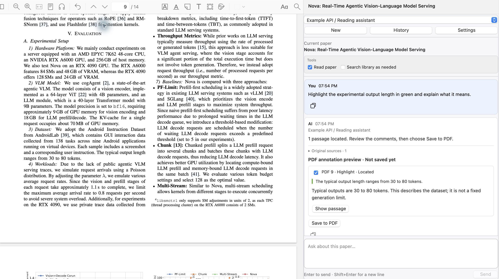
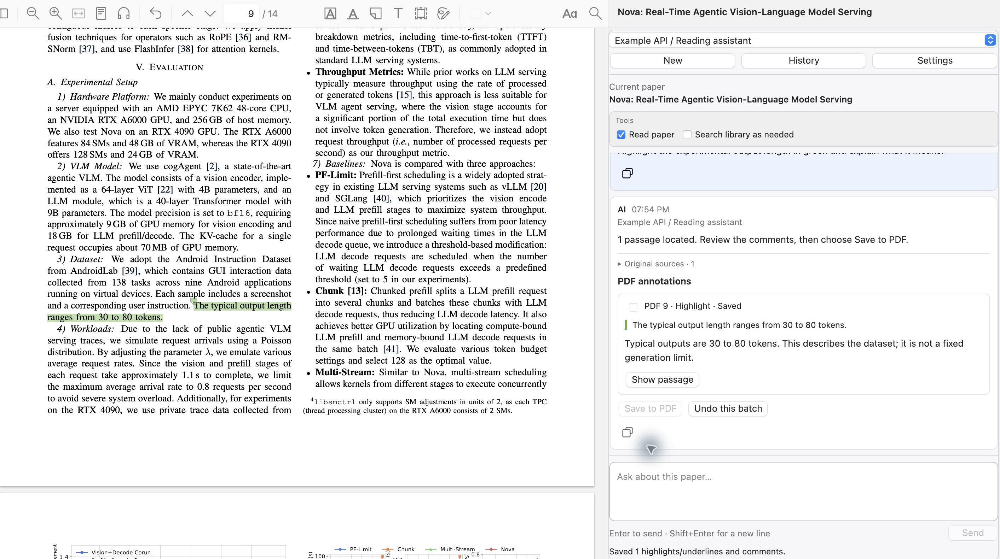

<h1 align="center">Zotero AI Reader</h1>

<p align="center"><strong>Your paper and your AI, in one window.</strong><br />
A lightweight, native sidebar for understanding and annotating what you read.</p>

<p align="center">
  <a href="#installation">Install</a> ·
  <a href="#reading-with-ai-reader">Features</a> ·
  <a href="#stable-and-preview">Preview</a> ·
  <a href="https://github.com/kcodea516/zotero-ai-reader/issues/new/choose">Report an issue</a> ·
  <a href="CONTRIBUTING.md">Contribute</a>
</p>

<p align="center">
  <a href="https://github.com/kcodea516/zotero-ai-reader/releases/latest"></a>
  <a href="https://github.com/kcodea516/zotero-ai-reader/releases"></a>
  <a href="https://github.com/kcodea516/zotero-ai-reader/actions/workflows/ci.yml"></a>
  <a href="LICENSE"></a>
</p>

Keep the paper open and ask your question beside it. AI Reader lives in Zotero's PDF reader, so you can work through an unfamiliar method without copying passages into a browser chat or switching between windows.

When an explanation helps, ask the assistant to mark the relevant passages and attach comments. The marks stay on the PDF, ready for your next reading session. You can review them, save them, and undo the batch from the same conversation.

The plugin uses Zotero's native controls and your own OpenAI-compatible API. Install one XPI and connect your model. The interface supports English and Chinese.

## Reading with AI Reader

Open a PDF, expand **AI Reader** in the right sidebar, and ask a question. The plugin can read the current PDF and include its text with your question. Answers show which papers and pages were supplied; select a page link to return to the source. For longer PDFs, the plugin selects relevant passages, so check the source list to see what was included.

You can also turn on **Search library as needed**. When a question calls for a comparison, the assistant can look for other papers in the same Zotero library, including other collections. Follow-up questions stay in the same conversation, and your history has its own searchable page.

Try asking:

> Explain the System Overview section. Which pages should I read alongside your explanation?

> Compare this method with another paper in my library. What trade-offs do the authors discuss?

Select text in the PDF and choose **Ask AI** to add a quotation to your question. Press **Enter** to send, or **Shift+Enter** for a new line.

### Ask with images · preview

Paste a screenshot, drop an image into the composer, or use the **+** button. Its thumbnail appears above your question; select it for a larger view or remove it with **×**. You can send an image on its own or attach up to four images to a question. Each image can be up to 12 MB, with a 24 MB total per message. Image questions require a vision-capable model.

### Generate and view images · preview

Ask for a PNG diagram in the conversation. AI Reader uses the selected endpoint's saved key and image model, then displays the result in the chat. Select an image to zoom, use the icon in its upper-right corner to copy it, or save it from the adjacent menu. PNG, JPEG, WebP, and complete SVG diagrams can be viewed; SVGs also have options to save or copy the source.

Open an SVG diagram to play its animation and click its controls. The viewer has pause, restart, zoom, and a timeline for SVG/CSS animations. Scripted diagrams can use their own buttons and sliders; restart resets the diagram. Saving or copying the SVG keeps its animation and scripts. The preview runs offline, so diagrams should include their code and images rather than load them from other sites.

You can attach a reference image and ask for a new image based on it. This uses your provider's Images Edit API. Image generation requires a provider and model that support the corresponding Images API; provider charges may apply.

### Ask, mark, and return to the paper · preview

> Highlight the experimental output length in green and explain what it means.

The assistant finds the passage in the current PDF and prepares a comment. **Show passage** takes you to the sentence; **Save to PDF** puts the mark on the page.

<p align="center"></p>

After saving, the green highlight appears in the paper. The chat keeps the explanation and an **Undo this batch** button, so you can remove those marks together if you change your mind.

<p align="center"></p>

*Captured in Zotero using a separate copy of the paper and a scripted model response. Passage matching, PDF annotations, and the save and undo controls are real.*

You can ask for highlights or underlines, choose a color, and refer to your earlier discussion: "Annotate the passages for the points we just listed." Each request can propose up to eight passages. Comments remain editable in Zotero's annotation sidebar.

### Export a conversation · preview

Choose **Export** on the right of the **Tools** bar below the paper title, select Markdown, TXT, or PDF, and choose where to save it. The export includes every message in the current conversation, quoted passages, and paper sources. Markdown embeds attached and generated images; PDF lays out text, tables, formulas, and static images across pages. TXT keeps the text and labels each image. Unsent drafts stay in the composer.

## Installation

The stable release includes paper Q&A, citations, library lookup, and history. The latest preview source, **1.4.0-beta.15**, adds image input, image generation, native PDF annotations, and conversation export. Get the XPI from a successful [preview CI build](https://github.com/kcodea516/zotero-ai-reader/actions/workflows/ci.yml?query=branch%3Acodex%2Fannotation-agent-preview) under **Artifacts → zotero-ai-reader-xpi**, or [build it locally](#build-from-source). GitHub requires sign-in to download CI artifacts. The older [beta.12 release](https://github.com/kcodea516/zotero-ai-reader/releases/tag/v1.4.0-beta.12) is still available, but lacks the latest annotation fixes.

1. Download `zotero-ai-reader-1.3.2.xpi` from the [stable release](https://github.com/kcodea516/zotero-ai-reader/releases/tag/v1.3.2).
2. In Zotero, open **Tools → Plugins**, then choose **Install Plugin From File** from the gear menu.
3. Select the XPI, open a PDF, and expand **AI Reader** in the right sidebar.
4. Open **Settings**, add an endpoint and model, and save.

The stable release targets Zotero 10.0.6–10.0.x and has been checked on macOS with Zotero 10.0.6. Windows and Linux reports are welcome. Installing the XPI does not require Node.js or Python. Install updates through the same menu; conversations and endpoint settings are preserved.

If you use Translate for Zotero, AI Reader appears below its translation section. The translation plugin is optional.

### Connect a model

In **Settings**, enter an endpoint name, Base URL, API key, model display name, and model ID. Multiple models can share an endpoint. Use an OpenAI-compatible Chat Completions endpoint, for example:

```text
https://api.example.com/v1
https://gateway.example.com/custom/v1/chat/completions
http://127.0.0.1:1234/v1
```

Public endpoints use HTTPS; HTTP is supported for local loopback addresses. Anthropic Messages, Gemini, and Responses protocols require a compatible gateway. The connection test sends a short request to your provider and may incur a charge.

For image generation, set the endpoint's **Image model ID** to a model your provider supports. A blank field uses `gpt-image-2.5-flare`; `/images/generations` must be available on that endpoint. Reference-image requests also require `/images/edits`. See the [Images API reference](https://developers.openai.com/api/reference/resources/images/methods/generate).

<details>
<summary>See settings</summary>


Choose the interface language, default model, system prompt, and message color here. The language setting changes the interface; ask the model or edit your prompt to change the language of its answers.

</details>

## Stable and preview

| Feature | Stable 1.3.2 | Preview 1.4.0-beta.15 |
| --- | --- | --- |
| Paper Q&A, citations, library lookup, history | Yes | Yes |
| Fold long user messages | — | Yes |
| Underline or highlight PDF passages with comments | — | Yes, with a review step |
| Image input, image generation, and viewer | — | Yes |
| Export conversations as Markdown, TXT, or PDF | — | Yes |
| Install | [Release XPI](https://github.com/kcodea516/zotero-ai-reader/releases/tag/v1.3.2) | [CI build](https://github.com/kcodea516/zotero-ai-reader/actions/workflows/ci.yml?query=branch%3Acodex%2Fannotation-agent-preview) · [Build locally](#build-from-source) |

The preview's text annotations are matched against PDF coordinates before saving. Ambiguous or unmatched passages cannot be saved, and editing an annotation blocks undo of its batch. The preview reads up to 80 pages and 110,000 characters for an annotation proposal. Its [validation record](https://github.com/kcodea516/zotero-ai-reader/blob/codex/annotation-agent-preview/VALIDATION.md) describes the tests run so far.

## Your data

Conversations and settings are stored locally in the Zotero profile and are not synced through Zotero. API keys use Zotero's encrypted storage and login manager; if encrypted storage is unavailable, the key lasts for the current session.

Questions, conversation history, attached images, and enabled paper excerpts are sent to the endpoint you choose. Library search uses an additional short routing request and can read up to three related local PDFs. Turn off the reading options if you do not want paper text included. Provider terms and charges apply. Extracted PDF text is cached in memory; ordinary chat history stores source metadata rather than the extracted PDF corpus.

PDF text extraction can miss figures, equations, or layout. Scanned documents need OCR. PDF page numbers start from the first page of the file, so use the linked pages to check answers against the paper.

## Help and contribute

Found a problem, or have an idea for the reader? Open a [GitHub issue](https://github.com/kcodea516/zotero-ai-reader/issues/new/choose) in English or Chinese. For bugs, include your Zotero and plugin versions, operating system, and steps to reproduce; please remove API keys and private material from screenshots and logs.

Testing on Windows and Linux, reports from different PDF layouts and providers, documentation improvements, and code contributions are all welcome. The [contribution guide](CONTRIBUTING.md) has setup and review details.

<details>
<summary>Troubleshooting</summary>

- Check the endpoint, API key, quota, and model ID if a request fails.
- Try disabling streaming for the endpoint if streaming fails.
- Download the PDF attachment and make sure its text is selectable if paper text is missing.
- Check profile permissions and disk space if history cannot be saved.

</details>

## Build from source

Use Node.js 24 or newer and Python 3:

```sh
git clone https://github.com/kcodea516/zotero-ai-reader.git
cd zotero-ai-reader
# For the preview features:
# git switch codex/annotation-agent-preview
npm ci
npm run typecheck
npm test
npm run build
```

The XPI is written to `build/`. Source code lives in `src/`, Zotero resources in `addon/`, and tests in `tests/`. See [VALIDATION.md](VALIDATION.md) for the checks and their scope.

Zotero AI Reader is an independent project released under the [MIT license](LICENSE).
