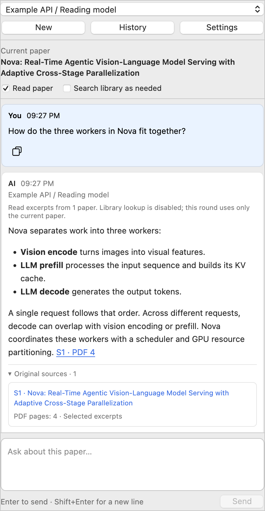
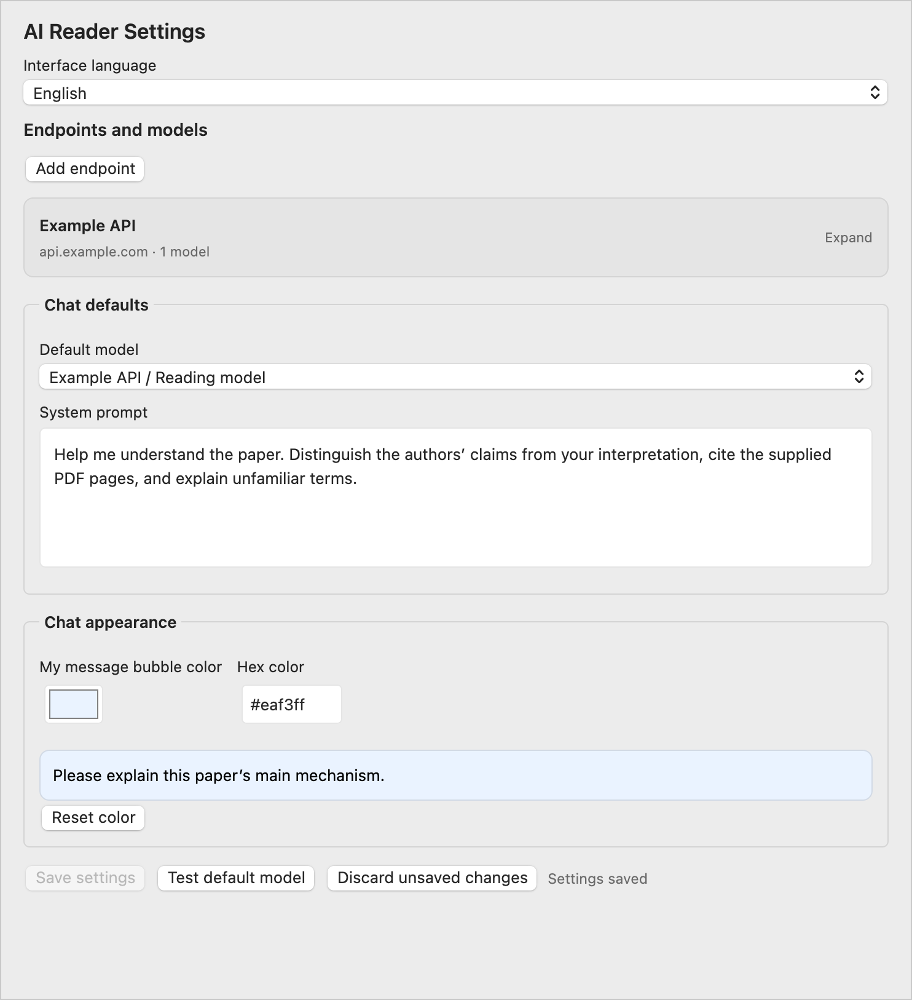

<h1 align="center">Zotero AI Reader:<br />Chat with your papers, inside Zotero</h1>

<p align="center">
  <strong>A native, simple sidebar for understanding papers.</strong><br />
  Ask about the paper you're reading, compare related work when needed, and open cited PDF pages.
</p>

<p align="center">
  <a href="#installation">Install</a> ·
  <a href="#configure-an-endpoint-and-model">User guide</a> ·
  <a href="CHANGELOG.md">Changelog</a> ·
  <a href="https://github.com/kcodea516/zotero-ai-reader/issues">Feedback</a>
</p>

<p align="center">
  <a href="https://github.com/kcodea516/zotero-ai-reader/releases/latest"></a>
  <a href="https://github.com/kcodea516/zotero-ai-reader/releases"></a>
  <a href="https://github.com/kcodea516/zotero-ai-reader/actions/workflows/ci.yml"></a>
  <a href="LICENSE"></a>
</p>

Zotero AI Reader uses Zotero’s native controls to keep paper discussions in the PDF sidebar. Ask about the current paper, follow up in the same conversation, and open the cited pages. The interface supports Chinese and English, with your own OpenAI-compatible Chat Completions endpoint.

## In use

<p align="center">
  
</p>

The sidebar keeps the follow-up input available below the conversation. Source cards identify the paper and PDF pages supplied for an answer. Other papers are searched only when needed and permitted.

Screenshots show the actual plugin UI on macOS with a sample conversation and example endpoint. The sample answer and source metadata are illustrative; no live provider call was made for these images.

## Installation

1. Download `zotero-ai-reader-1.3.2.xpi` from the [release page](https://github.com/kcodea516/zotero-ai-reader/releases/tag/v1.3.2).
2. In Zotero, open **Tools → Plugins**, then choose **Install Plugin From File** from the gear menu.
3. Select the XPI and open a PDF. Expand **AI Reader** in the right sidebar. When Translate for Zotero is installed, the assistant appears below the translation section.

Updates are installed manually using the same steps. Updating preserves local conversations and endpoint settings. The plugin has been checked on macOS with Zotero 10.0.6; other platforms and versions have not been verified. See [validation records](VALIDATION.md) for the scope of the checks.

## Annotation agent preview

Version `1.4.0-beta.2` adds an opt-in **Annotation agent** mode for the current PDF. This branch is a preview; the stable release remains 1.3.2. Automated tests pass, but installation and native annotation checks are pending.

1. Open a PDF and enable **Annotation agent** in the reading sidebar.
2. Enter an instruction such as “Highlight the main design choices and explain why each matters.” The configured model receives text from the current PDF and proposes up to eight highlights or underlines with comments.
3. Review the quoted passages and comments. **Show passage** opens the proposed position. Unmatched or ambiguous passages cannot be saved.
4. Select the annotations to keep and click **Save selected annotations**. Planning alone does not write annotations.
5. **Undo this batch** moves the saved annotations to Zotero Trash. If an annotation has been edited since saving, undo stops and preserves the batch.

Positions are matched locally against PDF text; the model cannot supply executable code, Zotero item keys, or drawing coordinates. Repeated saves use batch tags to avoid duplicates. Previews and saved annotation references remain in local conversation history, and copying a response includes its quotations and comments.

This preview annotates text in the current PDF only. It does not draw arbitrary circles, interpret figures, perform OCR, or annotate other papers. It reads at most 80 pages and 110,000 characters; skipped or omitted pages are disclosed. It uses Zotero reader internals that may change between versions. Keep the stable version for everyday use until the native checks are complete.

## Interface language

Open **Settings** in the sidebar and choose **Chinese** or **English** under **Interface language**. The settings preview changes immediately; click **Save settings** to apply the language to the sidebar, history page, source labels, and status messages. The choice is saved across restarts. Existing installations keep Chinese until you change it.

Changing the interface language preserves unsent questions, quotations, and unsaved endpoint fields. It does not translate saved conversations, paper titles, or your custom system prompt. To change the language of model answers, edit the system prompt or ask the model in your preferred language.

## Configure an endpoint and model

Open **Settings** in the assistant, or its pane in Zotero Settings. Add an endpoint with a name, Base URL, and API key, then add a model with a display name and the provider's actual model ID. Leaving the key field blank preserves an existing key; removing it requires the separate clear action.

Accepted URL examples:

```text
https://api.example.com/v1
https://gateway.example.com/custom/v1
https://gateway.example.com/v1/chat/completions
http://127.0.0.1:1234/v1
```

Replace these examples with your provider's address. Public endpoints must use HTTPS. HTTP is supported for local loopback addresses. URLs cannot contain credentials, query parameters, or fragments.

The endpoint must support the Chat Completions `model`, `messages`, and `stream` fields. Native Responses, Anthropic Messages, and Gemini protocols require a compatible gateway. Endpoint cards start collapsed and show the name, host, and model count. Expand a card to edit details; adding an endpoint opens it automatically. Model and key drafts are retained when a card is collapsed. Multiple models can share an endpoint, and different endpoints can use separate keys. The connection test sends a short request to the selected provider and may incur usage charges; it does not create a conversation.

<details>
<summary>Settings: collapsed endpoints, interface language, and message color</summary>



</details>

## Current paper and on-demand library lookup

Two permissions are saved per conversation. Both are enabled by default:

- **Read paper** reads the current paper's local PDF before answering.
- **Search library as needed** allows the assistant to look up other papers when the current question needs a comparison or additional literature evidence.

Library lookup covers the **same Zotero library**, including papers outside the current collection. It does not search other Zotero libraries or the web, and does not download missing papers.

Enabling lookup does not attach related PDFs to every question. After preparing any enabled current-paper evidence, the selected model makes a bounded routing decision. The routing prompt asks it to keep explanations, summaries, translations, and follow-up questions about the current paper on that paper alone. A positive decision can trigger a library search and extraction from up to three local PDFs. If the search matches explicitly named papers, it returns those matches without filling unused slots with broad topic matches. A previous comparison does not automatically carry those PDFs into the next question. If the routing decision fails, the plugin skips the lookup, keeps any available current-paper evidence, and reports the failure.

Routing uses an additional short request to the selected endpoint. It receives the current question, the last three questions, the current paper's title, and a bounded excerpt of the current paper when reading is enabled. It does not receive other papers' contents before deciding to search. Disable **Search library as needed** to skip both routing and library lookup. Disable both permissions to send only the question, manual quotations, and completed conversation history.

Short papers can be supplied in full. Longer papers use relevant pages and nearby passages. The current paper has a material budget of about 90,000 characters, and the combined evidence budget is 130,000 characters. Partial coverage is disclosed. Missing, encrypted, scanned, or otherwise unreadable PDFs are not treated as read. The plugin does not perform OCR, and text extraction may omit figures, complex equations, or layout relationships.

Answers with retrieved evidence have a source list showing the actual papers and pages supplied for that round. A citation such as `[S1 p.4]` opens the corresponding local PDF page. Pages are counted from the first page of the PDF, which may differ from printed page numbers. Source titles wrap above a separate page-number row.

## Conversations and history

Long user messages show a preview of about six lines, including quoted text. Use **Show more** and **Show less** to expand or collapse a message. Short messages and assistant answers remain fully visible. Copying, exporting, and sending conversation context always use the complete text.

- Press Enter to send, Shift+Enter for a newline, or Cmd/Ctrl+Enter to send.
- Select PDF text and choose **Ask AI** to add an editable quotation. Adding a quotation does not send a request.
- Continue in the same input after an answer. Long responses scroll within the message area.
- Switch models to continue the conversation with a different model. Each answer keeps its original endpoint and model label.
- Stop an active request or retry an incomplete round. Failed and stopped rounds are excluded from later conversation context.
- Open **History** for a separate history page. Cards show the conversation title, paper, update time, latest message, and round count. Search or filter by current paper/all history, select a card to enter, or return to the active conversation. Drafts are preserved when switching.
- Rename or delete an individual conversation from its card. Deletion requires confirmation.
- Copy a message using the icon below it, or copy the current conversation as Markdown from history.

Answers support Markdown, code blocks, and local LaTeX rendering. Completed conversation history is sent with the next question. Switching providers sends that history to the newly selected provider. If the provider reports an oversized context, disable library lookup, choose a model with a larger context window, or start a new conversation.

## Message colors

User messages have a light blue background by default (`#eaf3ff`). In **Settings → Chat appearance**, choose a color or enter a six-digit hex value. The preview updates immediately. Click **Save settings** to apply the color to existing and new user messages; the plugin selects black or white text for contrast. **Reset color** resets the color preview without changing endpoint or model settings; click **Save settings** to apply the reset. Assistant messages retain their existing appearance.

## Data and privacy

Conversations and non-secret settings are saved in the plugin's directory inside the Zotero profile. They are not synced through Zotero. API keys use Zotero's system secret storage and login manager. If encrypted storage is unavailable, the key is kept only for the current session and the interface reports this limitation.

Requests go directly to the endpoint you configure. Enabled reading permissions can send local paper text, including private documents, to that provider. The provider's own data-handling terms apply. Reading and lookup also increase request size and provider usage.

Extracted PDF text is cached in memory. Conversation files save questions, answers, reading permissions, and source metadata, without saving the automatically extracted PDF corpus. Model answers remain part of the saved conversation. The plugin does not upload PDFs, extracted text, keys, or private conversations to this GitHub repository. Remote images in model responses are not loaded automatically.

## Troubleshooting

- **Authentication or model errors:** check the endpoint, key permissions, quota, and actual model ID.
- **Streaming incompatibility:** disable streaming in the endpoint settings and retry.
- **Missing original text:** download the attachment and confirm the PDF contains selectable text. Scans need OCR in another tool.
- **Incomplete paper coverage:** inspect the source pages and partial-excerpt notice, and check figures or equations in the PDF itself.
- **History save errors:** check profile permissions and available disk space before quitting Zotero.

## Build from source

Use Node.js 24 or newer and Python 3:

```sh
npm ci
npm run typecheck
npm test
npm run build
```

The package is written to `build/zotero-ai-reader-1.3.2.xpi`. Source code is in `src/`, Zotero resources in `addon/`, and tests in `tests/`. The package includes local rendering libraries and fonts; installed users do not need Node.js. CI checks types, runs unit tests, builds the XPI, and uploads it as an artifact. Native Zotero integration fixtures are documented in [VALIDATION.md](VALIDATION.md).

## Feedback and contribution

Open an [issue](https://github.com/kcodea516/zotero-ai-reader/issues) with your Zotero version, operating system, reproduction steps, and a redacted screenshot. Do not include API keys, private conversation logs, or papers you are not allowed to share. Pull requests are welcome.

This is an independent Zotero plugin under the [MIT license](LICENSE), with no affiliation to the Zotero project.
